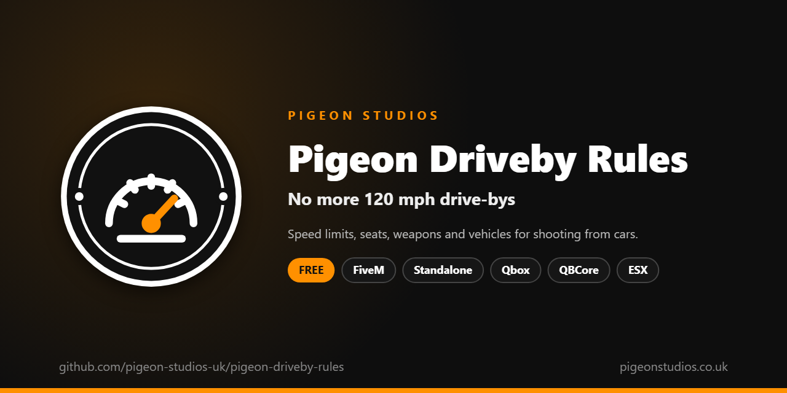

<div align="center">
  

  <h1>Pigeon Driveby Rules</h1>

  <p><strong>Sets who can shoot from vehicles, from which seats, up to what speed, with which weapons and in which vehicles.</strong></p>

  <p>
    <a href="https://github.com/pigeon-studios-uk/pigeon-driveby-rules/releases/latest"></a>
    <a href="LICENSE.md"></a>
    <a href="https://discord.gg/2NFVWEUmDF"></a>
    
  </p>

  <p>
    <a href="https://github.com/pigeon-studios-uk/pigeon-driveby-rules/releases/latest"><strong>Download</strong></a> ·
    <a href="#installation">Install</a> ·
    <a href="#configuration">Configure</a> ·
    <a href="CHANGELOG.md">Changelog</a> ·
    <a href="https://discord.gg/2NFVWEUmDF">Support</a>
  </p>
</div>

---

## Contents

- [Overview](#overview)
- [Features](#features)
- [What players see](#what-players-see)
- [Requirements](#requirements)
- [Installation](#installation)
- [Updating](#updating)
- [Configuration](#configuration)
- [Examples](#examples)
- [Exemptions](#exemptions)
- [Exports](#exports)
- [Localisation](#localisation)
- [How it works](#how-it-works)
- [Update checker](#update-checker)
- [Performance](#performance)
- [Security](#security)
- [Troubleshooting](#troubleshooting)
- [FAQ](#faq)
- [Support](#support)
- [Contributing](#contributing)
- [Licence](#licence)
- [Credits](#credits)

## Overview

Pigeon Driveby Rules is a free resource by [Pigeon Studios](https://pigeonstudios.co.uk) that puts limits on shooting from vehicles. GTA lets anyone fire out of a car at any speed, which turns every chase into a drive-by at 120 mph. With this resource you decide who can shoot from which seat, how fast the vehicle can be going, which weapons can be used, and which vehicles nobody can shoot from at all.

Players who break a rule simply can't aim or fire from the vehicle until it no longer applies (slowing down, for example), and a short message tells them why. Jobs such as police can be exempt, on duty or always, and so can anyone with an ACE permission.

## Features

- **Speed limits by seat.** Give the driver, the front passenger and the rear seats each their own limit, in mph or km/h, or none.
- **Seats.** Stop the driver, the front passenger or the rear seats from shooting at all.
- **Weapons.** Allow any weapon GTA allows, only the ones you list, or all but the ones you list, by weapon name (`WEAPON_MICROSMG`) or weapon group (`GROUP_SMG`). Add-on weapons work too.
- **Vehicles.** Block whole vehicle classes, such as motorcycles or helicopters, and single vehicles by spawn name, with exceptions such as one police helicopter.
- **A moment to settle in.** Optionally, no shooting for a second or so after getting in.
- **Exemptions.** By ACE permission, and by job with Qbox, QBCore or ESX, on duty only or always. Other resources can exempt players through an export.
- **Tells players why.** Trying to aim shows a short reason, at most once every few seconds. Uses ox_lib notifications if you have it, otherwise GTA's own.
- **Optional first person.** Switch to first person while shooting from a vehicle, and back afterwards.
- **23 languages.** Every message is in `locales/`, and it follows ox_lib's language setting.
- **Standalone.** No framework needed; job exemptions use one if it's there.

## What players see

A passenger trying to aim out of the window at 75 mph, with a 60 mph limit:

```text
Drive-by
Too fast to shoot. Slow down to 60 mph or less.
```

The other messages:

| Why | Message |
|---|---|
| Blocked vehicle | You can't shoot from this vehicle. |
| Seat not allowed | You can't shoot from this seat. |
| Weapon not allowed | You can't use this weapon from a vehicle. |
| Just got in | You've only just got in. Give it a moment. |

With no weapon out, nothing is stopped: GTA's middle-finger gesture from a vehicle still works.

## Requirements

| Requirement | Version | Notes |
|---|---|---|
| FXServer | A [recommended artifact](https://runtime.fivem.net/artifacts/) | |
| [ox_lib](https://github.com/communityox/ox_lib) | Optional | Used for the message if it's running |
| [Qbox](https://github.com/Qbox-project/qbx_core), [QBCore](https://github.com/qbcore-framework/qb-core) or [ESX Legacy](https://github.com/esx-framework/esx_core) | Optional | Only for job exemptions |

**Frameworks:** none needed. It works the same on standalone servers, ESX Legacy, QBCore, Qbox and ox_core. Job exemptions need Qbox, QBCore or ESX; ACE exemptions work everywhere.

## Installation

1. **Download** `pigeon-driveby-rules.zip` from the [latest release](https://github.com/pigeon-studios-uk/pigeon-driveby-rules/releases/latest). Don't use the green **Code** button; release zips are the tested builds.
2. **Extract** it into your server's `resources` folder. The folder must be called `pigeon-driveby-rules`.
3. **Start it** by adding this to `server.cfg`, after your framework and ox_lib if you use them:

   ```cfg
   ensure pigeon-driveby-rules
   ```

4. **Set your rules** in `configuration/config.lua` (see [Configuration](#configuration)). Out of the box: drivers can shoot up to 20 mph, passengers up to 60 mph, with a one-second wait after getting in, and nobody is exempt.
5. **Optional:** let staff or jobs ignore the rules (see [Exemptions](#exemptions)).
6. **Restart** your server. The console shows one line from the update checker:

   ```text
   [Pigeon Studios] Pigeon Driveby Rules v1.0.0 is up to date.
   ```

## Updating

1. Read the [changelog](CHANGELOG.md) for every version between yours and the latest, especially any **Upgrade notes**.
2. Back up your `configuration/` and `locales/` folders.
3. Replace the `pigeon-driveby-rules` folder with the new release.
4. Copy your rules into the new `configuration/config.lua`. Don't copy the old file over the new one; new versions can add settings.
5. Restart the resource.

## Configuration

All settings are in `configuration/config.lua`, each with a comment explaining it.

| Setting | Default | What it does |
|---|---|---|
| `Config.Locale` | `'auto'` | Language: `'auto'` follows ox_lib's language, or a code from `locales/` such as `'de'` |
| `Config.Seats` | driver 20, front 60, rear 60 | For `driver`, `front` (the front passenger) and `rear` (every seat behind): `allowed` (can they shoot at all) and `maxSpeed` (`0` for no limit) |
| `Config.SpeedUnit` | `'mph'` | `'mph'` or `'kmh'`, for every `maxSpeed` |
| `Config.EnterDelaySeconds` | `1` | Seconds after getting in before shooting is allowed. `0` for none |
| `Config.Weapons.mode` | `'all'` | `'all'`, `'allow'` (only `list`) or `'block'` (all but `list`) |
| `Config.Weapons.list` | `{}` | Weapon names (`'WEAPON_MICROSMG'`) and groups (`'GROUP_SMG'`) |
| `Config.Vehicles.blockClasses` | `{}` | Vehicle classes nobody can shoot from, by number |
| `Config.Vehicles.blockModels` | `{}` | Vehicles nobody can shoot from, by spawn name |
| `Config.Vehicles.allowModels` | `{}` | Vehicles never blocked by `blockClasses` |
| `Config.Exempt.ace` | `'pigeon-driveby-rules.exempt'` | ACE permission that ignores every rule. `''` turns it off |
| `Config.Exempt.jobs` | `{}` | Jobs that ignore every rule, with Qbox, QBCore or ESX |
| `Config.Exempt.onDutyOnly` | `true` | Job exemptions only while on duty |
| `Config.ExemptRefreshSeconds` | `60` | How often exemptions are checked again, as well as on job and duty changes |
| `Config.FirstPerson` | `false` | First person while shooting from a vehicle |
| `Config.ShowMessage` | `true` | Tell players why they can't shoot when they try to aim |
| `Config.MessageCooldown` | `4` | Seconds between messages |
| `Config.Notifications` | `'auto'` | `'auto'` (ox_lib if it's running), `'ox_lib'` or `'gta'` |

**Weapon groups:** `GROUP_PISTOL`, `GROUP_SMG`, `GROUP_RIFLE`, `GROUP_SHOTGUN`, `GROUP_MG`, `GROUP_SNIPER`, `GROUP_HEAVY`, `GROUP_THROWN` and `GROUP_MELEE`. GTA itself only lets players use weapons from a vehicle that have a drive-by animation, mostly pistols and SMGs, so this can narrow what's allowed but never widen it.

**Vehicle classes:** 0 compacts · 1 sedans · 2 SUVs · 3 coupes · 4 muscle · 5 sports classics · 6 sports · 7 super · 8 motorcycles · 9 off-road · 10 industrial · 11 utility · 12 vans · 13 cycles · 14 boats · 15 helicopters · 16 planes · 17 service · 18 emergency · 19 military · 20 commercial · 21 trains · 22 open wheel. [The full list](https://docs.fivem.net/natives/?_0x29439776AAA00A62).

## Examples

**Drivers never shoot; passengers up to 40 mph:**

```lua
Config.Seats = {
    driver = { allowed = false, maxSpeed = 0 },
    front  = { allowed = true,  maxSpeed = 40 },
    rear   = { allowed = true,  maxSpeed = 40 },
}
```

**Only pistols from vehicles:**

```lua
Config.Weapons = { mode = 'allow', list = { 'GROUP_PISTOL' } }
```

**No shooting from motorcycles or helicopters, except the police Maverick:**

```lua
Config.Vehicles = {
    blockClasses = { 8, 15 },
    blockModels = {},
    allowModels = { 'polmav' },
}
```

**Police and sheriffs on duty ignore the rules:**

```lua
Config.Exempt = {
    ace = 'pigeon-driveby-rules.exempt',
    jobs = { 'police', 'sheriff' },
    onDutyOnly = true,
}
```

## Exemptions

Exempt players ignore every rule: any seat, any speed, any weapon GTA allows, any vehicle.

**By ACE permission**, granted in `server.cfg`:

```cfg
add_ace group.admin pigeon-driveby-rules.exempt allow
```

**By job**, with Qbox, QBCore or ESX: list the job names (the name, such as `police`, not the label) in `Config.Exempt.jobs`. With `Config.Exempt.onDutyOnly`, the exemption only applies while the player is on duty. ESX versions without a duty system count everyone as on duty.

Exemptions are worked out on the server when a player joins, when their character loads, whenever their job or duty changes, and every `Config.ExemptRefreshSeconds`, which catches ACE permissions given while the server runs.

## Exports

Server exports, for other resources:

```lua
-- Make a player exempt from every rule (true), subject to every rule even if Config.Exempt says
-- otherwise (false), or back to Config.Exempt (nil). Lasts until they leave the server.
exports['pigeon-driveby-rules']:SetExempt(source, true)

-- True if the rules don't apply to this player right now.
local exempt = exports['pigeon-driveby-rules']:IsExempt(source)
```

## Localisation

Pigeon Driveby Rules comes in 23 languages: `en` English, `cs` Czech, `da` Danish, `de` German, `es` Spanish, `et` Estonian, `fi` Finnish, `fr` French, `hr` Croatian, `hu` Hungarian, `id` Indonesian, `it` Italian, `nl` Dutch, `no` Norwegian, `pl` Polish, `pt` Portuguese, `pt-br` Brazilian Portuguese, `ro` Romanian, `sl` Slovenian, `sv` Swedish, `tr` Turkish, `zh-cn` Simplified Chinese and `zh-tw` Traditional Chinese. They're the languages ox_lib ships, so your server may already have one set.

With `Config.Locale = 'auto'` (the default), it uses ox_lib's language, so one line in `server.cfg` sets it for this and every other resource that follows ox_lib:

```cfg
setr ox:locale "de"
```

Use `setr`, not `set`, so players' games get it too. Without it, or for a language that isn't in `locales/`, the text is English. To choose a language for this resource only, set `Config.Locale` to its code, such as `'fr'` or `'pt-br'`.

Chinese text can show as blank in GTA's own text, such as its notifications and help messages, because GTA only loads its Chinese font when the game itself is set to Chinese. ox_lib's notifications show every language.

Every file was checked for missing text and placeholders, but not every translation has been read by a native speaker yet. If something reads wrong, please send a fix; see [Contributing](#contributing). To add a language, copy `locales/en.lua` to a new file named with the language's code (such as `ja.lua`), change `Locales.en` at the top to match (`Locales.ja`), and translate the text in quotes. Keep words in `{curly brackets}` as they are.

## How it works

Outside a vehicle, the resource checks twice a second and does nothing else. In a vehicle, every frame it works out:

1. which seat the player is in: driver, front passenger or rear;
2. the vehicle's speed, class and model, and how long the player has been in it;
3. the weapon they have selected and its group;
4. whether the server has marked them exempt.

Then it checks the rules in this order: blocked vehicle, seat, speed, weapon, settling in. If one applies, it turns off GTA's drive-by for the player (`SetPlayerCanDoDriveBy`), so they can't aim or fire from the vehicle, and if they try to aim it shows the reason. As soon as no rule applies, drive-bys come back. They also come back when the player gets out, or when the resource stops.

With `Config.FirstPerson`, while the player is shooting from the vehicle the camera switches to first person, and back to the player's own view when they stop.

The server only works out exemptions and passes them to each player's game in a state bag (`pigeonDrivebyExempt`). Everything else runs in each player's own game, which FiveM does automatically for client scripts.

## Update checker

When it starts, Pigeon Driveby Rules checks our public [version registry](https://github.com/pigeon-studios-uk/pigeon-versions) once and prints one line in the server console saying whether it's up to date. If there's an update, it shows what's new and where to get it. The check is a single request to GitHub and sends nothing about your server or players.

Control it for every Pigeon Studios resource at once in `server.cfg`:

```cfg
set pigeon_update_check "on"      # default: one short line
set pigeon_update_check "quiet"   # only print when there's an update or a problem
set pigeon_update_check "off"     # never check
```

## Performance

Outside a vehicle it checks twice a second and does nothing else. In a vehicle it runs every frame, which costs very little: a few quick look-ups about the vehicle and weapon, and drive-bys are only switched when the answer changes. On the server, exemptions are checked once a minute and on job changes, which is a quick look-up per player.

## Security

- It only changes what the player's own character can do from a vehicle, in their own game.
- Exemptions are decided on the server, from ACE permissions and the framework's own job data. The `SetExempt` export can only be called by resources on your server.
- It has no commands and no network events, so players can't send it anything.
- The only network request is the update check at start-up, from the server to GitHub. It sends nothing about your server or players.
- Like every rule that runs in the player's game, a player with a modified game could get around it. It's a gameplay rule, not an anti-cheat; pair it with your anti-cheat if that matters on your server.

Found a problem? Please don't open a public issue. Use the **Report a vulnerability** button in this repository's **Security** tab, or follow our [Security Policy](https://github.com/pigeon-studios-uk/.github/blob/main/SECURITY.md).

## Troubleshooting

**Players can shoot from a vehicle I blocked.**
Check you've used the spawn name, not the display name. If it's an add-on vehicle, the spawn name is the `modelName` in its `vehicles.meta`. Check it isn't also in `allowModels`, and that the player isn't exempt.

**A weapon I allowed can't be used from vehicles.**
GTA only lets players use weapons from a vehicle that have a drive-by animation. This resource can narrow that list, not widen it.

**Police are still stopped, even though I listed the job.**
Use the job's name (such as `police`), not its label. With `onDutyOnly`, they need to be on duty. Job exemptions need Qbox, QBCore or ESX, started before this resource.

**I also run Pigeon No Weapons In Vehicles.**
Both resources switch drive-bys off and on, so in the vehicles No Weapons In Vehicles covers, the two can disagree for a moment, such as just after the settling-in wait. Put the same vehicles in `Config.Vehicles.blockModels` or `blockClasses` here as well, and they'll always agree.

**Another resource turns drive-bys off and this one turns them back on.**
This resource only turns drive-bys back on after it turned them off itself, but if another resource does the same, the last one wins. Stop one of them to test, and set the rules in one place.

**The console says "isn't in the version registry" or "couldn't check for updates".**
Your server couldn't reach GitHub, or the check is blocked by a firewall. The resource works normally either way. Turn the check off with `set pigeon_update_check "off"`.

## FAQ

**Is it really free?**
Yes. Use it on as many servers as you like, including ones that take donations. You just can't reupload, resell or bundle it. See [Licence](#licence).

**Does it stop a vehicle's own guns, such as a Buzzard's?**
No. It's for the weapons players carry, and doesn't touch a vehicle's own weapons.

**Does it take weapons away?**
No. Players keep their weapons and can use them as soon as they're out of the vehicle, or a rule no longer applies.

**Does it affect NPCs?**
No. It only changes what players can do.

**Can players lean out of the window and shoot all the way round?**
Not with this resource; it sets rules for GTA's own drive-bys.

## Support

Read [Troubleshooting](#troubleshooting) first, then ask in the support channels of our [Discord](https://discord.gg/2NFVWEUmDF). Please include your Pigeon Driveby Rules version, FXServer artifact, framework and any errors from the console (F8 in game). See [Getting help](https://github.com/pigeon-studios-uk/.github/blob/main/SUPPORT.md).

Found a bug? Open a [bug report](https://github.com/pigeon-studios-uk/pigeon-driveby-rules/issues/new/choose).

## Contributing

Fixes, improvements and translations are welcome. Please read the [contributing guide](https://github.com/pigeon-studios-uk/.github/blob/main/CONTRIBUTING.md) first, and open a feature request before working on anything big.

## Licence

Pigeon Driveby Rules is free to use under the **[Pigeon Studios Free Licence](LICENSE.md)**.

- ✅ Use it on any number of servers, including monetised ones
- ✅ Change it for your own servers
- ✅ Show it in videos and streams
- ❌ Don't reupload, share or mirror the files; link to this repository instead
- ❌ Don't sell it, bundle it in packs, or put it behind escrow
- ❌ Don't remove the credits

This summary isn't the licence; [LICENSE.md](LICENSE.md) is. Third-party components are listed in [NOTICE.md](NOTICE.md).

## Credits

Made by [Pigeon Studios](https://pigeonstudios.co.uk). Thanks to everyone who has contributed fixes and translations; see the [changelog](CHANGELOG.md).

<sub>Not affiliated with or endorsed by Rockstar Games, Take-Two Interactive or Cfx.re.</sub>
